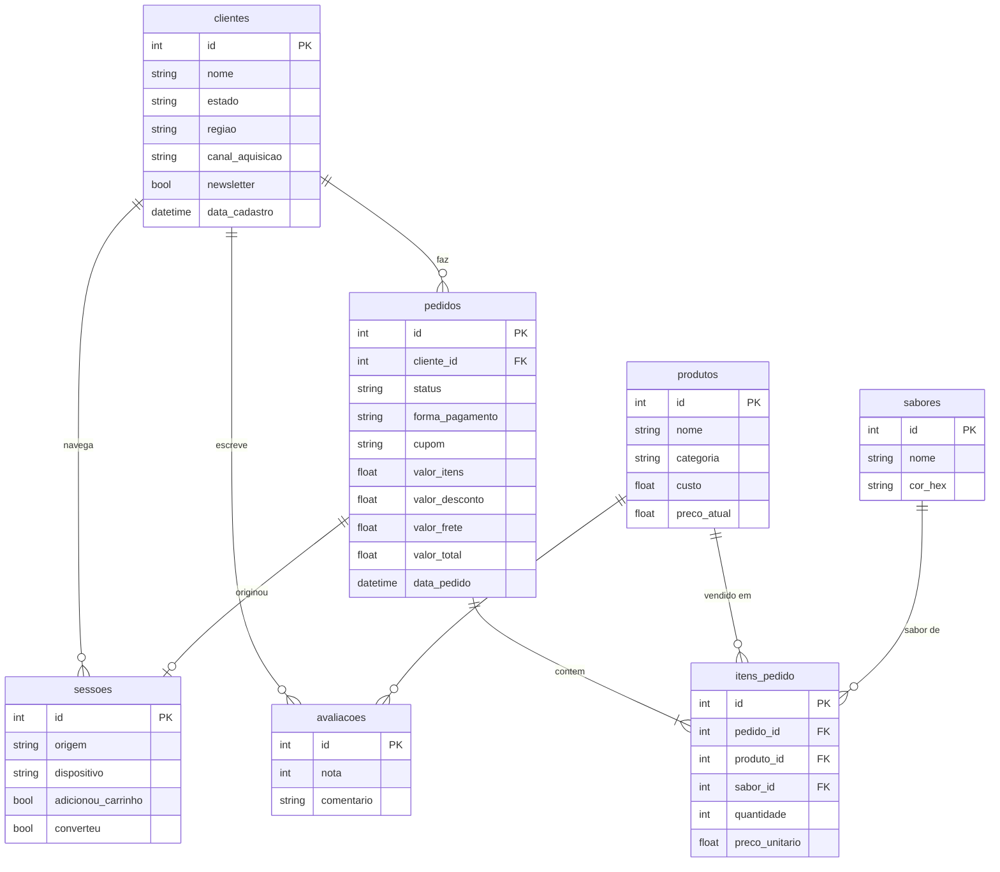

<div align="center">

# ⚡ SPARK

**Loja fictícia de energéticos, do front 3D ao dashboard de dados.**
Um projeto fullstack que percorre o ciclo inteiro: interface, banco de dados, dados simulados e análise.


</div>

---

## 🎬 Demonstração


> 📹 **[ COLE AQUI O LINK OU O VÍDEO DA DEMO ]**

---

## 🖼️ Telas

<!-- Salve os prints em docs/screenshots/ e ajuste os nomes abaixo. -->

| Hero com lata 3D | Seletor de sabores |
|---|---|
|  |  |

| Carrossel de produtos | Histórias de atletas |
|---|---|
|  |  |

| Versão mobile | Rodapé e newsletter |
|---|---|
|  |  |

---

## 📖 Sobre o projeto

A SPARK nasceu como um laboratório para mostrar, em um só repositório, **como as peças de um produto digital se encaixam**:

1. **Um site** com identidade forte (tema dark, verde neon) e uma experiência 3D.
2. **Um banco de dados relacional** modelado do zero.
3. **Dados simulados realistas**, gerados por script, com regras de negócio.
4. **Um dashboard de BI** em cima desses dados, para responder perguntas de negócio.

Não é uma loja em produção: a marca, os produtos, os clientes e os pedidos são **fictícios**.

---

## ✨ Funcionalidades do site

- **Hero com lata 3D arrastável**, renderizada com Three.js, que gira com o mouse ou o toque.
- **Seletor de sabores por cor:** ao escolher o sabor, a lata muda de cor.
- **Carrossel "Energy Drinks"** com cards de produto.
- **Seção "Além dos Limites"** com histórias de atletas.
- **Newsletter** no rodapé.
- **Tema dark** com verde neon, responsivo com Tailwind CSS.

---

## 🧰 Stack

| Camada | Tecnologia | Para que serve no projeto |
|---|---|---|
| Framework | **Next.js** | Rotas, renderização e API do site |
| Linguagem | **TypeScript** | Tipagem de ponta a ponta, do banco à interface |
| Estilo | **Tailwind CSS** | Design system dark/neon e responsividade |
| 3D | **Three.js** | Lata 3D interativa no hero |
| ORM | **Prisma** | Schema, migrações e consultas tipadas |
| Banco | **PostgreSQL** | Dados relacionais de pedidos, clientes e sessões |
| Dados falsos | **Faker** | Seed com milhares de registros plausíveis |
| BI | **Power BI** (Power Query + DAX) | Dashboard de 6 páginas sobre os dados gerados |

---

## 🗄️ Modelo de dados

O schema é definido no Prisma e vive em PostgreSQL.



---

## 🎲 Dados simulados (Faker)

O script de seed gera um histórico de um ano de operação, com regras de negócio em vez de valores aleatórios soltos:

- **~3.100 clientes**, distribuídos por estado e região, com canal de aquisição (Instagram, TikTok, Google, E-mail, Influenciador, Direto).
- **~3.950 pedidos** com status (entregue, enviado, pago, cancelado, reembolsado), formas de pagamento (Pix, cartão, boleto) e cupons como `PRIMEIRACOMPRA`, `SPARK10`, `BLACKSPARK` e `ATLETA15`.
- **~5.400 itens de pedido** ligados a 6 produtos e 7 sabores.
- **120 mil sessões de navegação**, com origem, dispositivo, carrinho e conversão.
- **~750 avaliações** com nota de 1 a 5.

---

## 📊 Dashboard em Power BI

Os dados do banco alimentam um relatório com **6 páginas** e cerca de 40 medidas DAX:

| Página | O que responde |
|---|---|
| Resumo executivo | Quanto faturou, com que margem e de onde vem |
| Vendas | Ritmo diário, horários de pico, pagamento e cupons |
| Produtos e sabores | Qual produto e sabor sustentam volume e margem |
| Clientes | Quem compra, de onde vem e quanto volta |
| Marketing e funil | Onde o tráfego converte e onde se perde |
| Operações e satisfação | Cancelamentos e nota dos clientes |

<!-- Salve os prints do Power BI em docs/screenshots/ -->

| Resumo executivo | Vendas |
|---|---|
|  |  |

| Produtos e sabores | Marketing e funil |
|---|---|
|  |  |

---

## 🚀 Como rodar

### Pré-requisitos

- Node.js (versão LTS)
- PostgreSQL rodando localmente ou em um serviço na nuvem

### Passo a passo

```bash
# 1. Clone o repositório
git clone https://github.com/SEU-USUARIO/spark.git
cd spark

# 2. Instale as dependências
npm install

# 3. Configure o ambiente
cp .env.example .env
# edite DATABASE_URL com os dados do seu PostgreSQL

# 4. Crie as tabelas com o Prisma
npx prisma migrate dev

# 5. Popule o banco com dados falsos
npx prisma db seed

# 6. Rode o site
npm run dev
```

Acesse [http://localhost:3000](http://localhost:3000).

> Ajuste os comandos de seed e de execução se os scripts do seu `package.json` tiverem outros nomes.

Para explorar o banco visualmente:

```bash
npx prisma studio
```


## 👤 Autor

Feito por **Junior**, estudante de Análise e Desenvolvimento de Sistemas.

[](https://www.linkedin.com/in/SEU-PERFIL)
[](https://github.com/SEU-USUARIO)

---

<div align="center">

⚠️ Projeto educacional. SPARK é uma marca fictícia e todos os dados são gerados artificialmente.

</div>